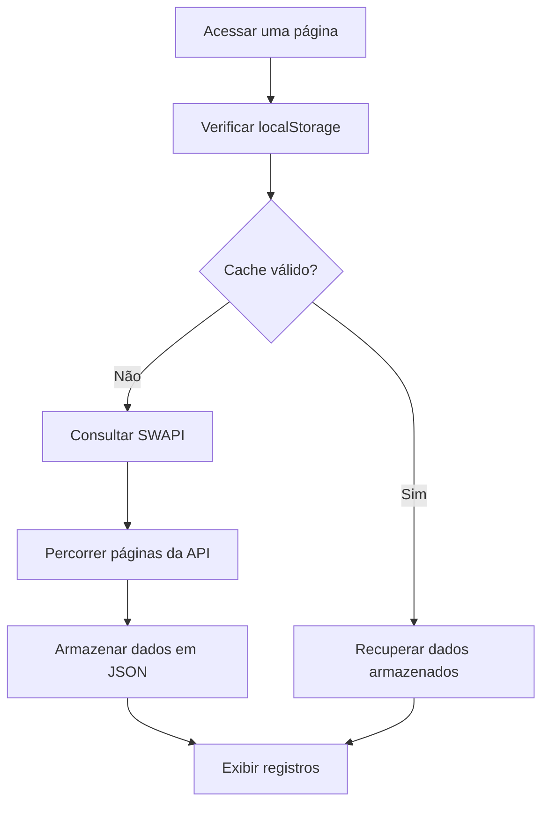

# 🌌 Star Wars Nexus


## 📖 Sobre o projeto

O **Star Wars Nexus** é uma aplicação web interativa que permite explorar o universo de Star Wars por meio de informações disponibilizadas pela **SWAPI (Star Wars API)**.

O website reúne personagens, planetas, naves espaciais e filmes da franquia em uma interface temática, responsiva e intuitiva, permitindo pesquisar registros e consultar suas informações detalhadas.

Desenvolvido como projeto acadêmico da disciplina de **Construção de Interfaces Web (ARQCIWB)**, do curso de Tecnologia em Sistemas para Internet do Instituto Federal de São Paulo (IFSP).

---

## ✨ Funcionalidades

- Navegação entre páginas independentes.
- Consumo de uma API REST pública.
- Carregamento automático dos registros.
- Paginação automática das requisições à API.
- Criação dinâmica de cards utilizando JavaScript.
- Pesquisa por nome ou título.
- Ordenação alfabética dos resultados.
- Visualização de informações detalhadas em modais do Bootstrap.
- Armazenamento de dados em cache utilizando `localStorage`.
- Sistema de favoritos para naves espaciais.
- Tratamento de erros e resultados vazios.
- Interface responsiva para computadores, tablets e celulares.

---

## 🪐 Explore a galáxia

| Página | Descrição |
|---|---|
| 🏠 Início | Apresentação do projeto e acesso às categorias disponíveis. |
| 👤 Personagens | Informações sobre os personagens e suas características. |
| 🌍 Planetas | Dados sobre clima, terreno, população e características dos planetas. |
| 🚀 Naves | Especificações técnicas, modelos, fabricantes e características das naves espaciais. |
| 🎬 Filmes | Informações sobre os filmes disponibilizados pela SWAPI. |

---

## 🛠️ Tecnologias utilizadas

| Tecnologia | Aplicação |
|---|---|
| HTML5 | Estrutura e semântica das páginas. |
| CSS3 | Estilização, identidade visual e responsividade. |
| JavaScript | Interatividade, manipulação do DOM e processamento dos dados. |
| Bootstrap 5.3.8 | Componentes, modais e responsividade. |
| Fetch API | Requisições HTTP à API. |
| LocalStorage | Armazenamento de cache e favoritos. |
| JSON | Formato de armazenamento e transferência dos dados. |
| Git e GitHub | Controle de versões e desenvolvimento colaborativo. |

---

## 🌐 Integração com a API

O projeto utiliza a **SWAPI — Star Wars API**, uma API pública que disponibiliza informações sobre o universo Star Wars.

**Site oficial:** [swapi.dev](https://swapi.dev/)

### Endpoints utilizados

| Recurso | Endpoint |
|---|---|
| Personagens | `/api/people/` |
| Planetas | `/api/planets/` |
| Naves espaciais | `/api/starships/` |
| Filmes | `/api/films/` |

As requisições são realizadas utilizando `fetch` e `async/await`.

Como a API pode retornar os registros de forma paginada, o sistema utiliza o campo `next` das respostas para percorrer as páginas e reunir todos os registros disponíveis.

---

## 💾 Sistema de cache

Para melhorar o desempenho e reduzir o número de requisições à SWAPI, o projeto utiliza um sistema de cache baseado no `localStorage` do navegador.

### Fluxo de funcionamento



Os dados armazenados possuem validade de **24 horas**. Durante esse período, o sistema pode reutilizar os registros locais sem realizar novas consultas à API.

Os favoritos são armazenados separadamente, permitindo que as escolhas do usuário sejam mantidas após o fechamento ou atualização da página.

---

## 📁 Estrutura do projeto

```text
Star-Wars-Nexus/
│
├── index.html
│
├── pages/
│   ├── personagens.html
│   ├── planetas.html
│   ├── naves.html
│   └── filmes.html
│
├── css/
│   ├── bootstrap.min.css
│   ├── global.css
│   ├── home.css
│   ├── recursos.css
│   ├── personagens.css
│   ├── planetas.css
│   └── naves.css
│
├── js/
│   ├── bootstrap.bundle.min.js
│   ├── api.js
│   ├── busca.js
│   ├── cache.js
│   ├── main.js
│   └── modal.js
│
├── assets/
│   ├── imagens/
│   └── fontes/
│
├── .gitignore
├── LICENSE-BOOTSTRAP.txt
├── DOCUMENTACAO.md
└── README.md
```

### Organização do JavaScript

| Arquivo | Responsabilidade |
|---|---|
| `api.js` | Comunicação com a SWAPI, validação de URLs e paginação das requisições. |
| `busca.js` | Normalização de textos, pesquisa e ordenação dos registros. |
| `cache.js` | Gerenciamento do armazenamento local, validade do cache e favoritos. |
| `main.js` | Inicialização das páginas, criação dos cards e gerenciamento da interface. |
| `modal.js` | Construção e apresentação dos detalhes dos registros. |

A separação dos arquivos facilita a manutenção, a reutilização de código e a organização das responsabilidades do sistema.

---

## 🚀 Como executar o projeto

### Pré-requisitos

- Visual Studio Code.
- Extensão Live Server.
- Navegador atualizado.
- Conexão com a internet para consultar a SWAPI.

### 1. Clone o repositório

```bash
git clone https://github.com/ryanluccadev/Star-Wars-Nexus.git
```

### 2. Acesse a pasta do projeto

```bash
cd Star-Wars-Nexus
```

### 3. Abra no Visual Studio Code

```bash
code .
```

### 4. Execute com Live Server

Abra o arquivo `index.html`, clique com o botão direito e selecione **Open with Live Server**.

O projeto será aberto no navegador e estará disponível para navegação.

Não é necessário instalar dependências com NPM ou configurar um backend. Os arquivos do Bootstrap estão incluídos no projeto.

---

## 📱 Responsividade e acessibilidade

O projeto utiliza Bootstrap e CSS para adaptar a interface a diferentes tamanhos de tela.

Também incorpora recursos de acessibilidade, como:

- Elementos semânticos do HTML5.
- Textos alternativos em imagens.
- Rótulos nos campos de pesquisa.
- Identificação da página ativa.
- Links para acesso direto ao conteúdo.
- Modais com recursos de acessibilidade do Bootstrap.

---

## 👨‍💻 Desenvolvedores

| Desenvolvedor | GitHub |
|---|---|
| Ryan Lucca Marques Pereira | [@ryanluccadev](https://github.com/ryanluccadev) |
| Pedro Aragoni | |

---

## 🎓 Informações acadêmicas

| Informação | Descrição |
|---|---|
| Instituição | Instituto Federal de São Paulo — IFSP |
| Curso | Tecnologia em Sistemas para Internet |
| Disciplina | Construção de Interfaces Web — ARQCIWB |
| Semestre | 2º semestre |
| Projeto | Website multipágina com consumo de API REST |
| API escolhida | SWAPI — Star Wars API |
| Ano | 2026 |

---

## 📚 Referências

- [SWAPI — Star Wars API](https://swapi.dev/)
- [Bootstrap](https://getbootstrap.com/)
- [MDN Web Docs](https://developer.mozilla.org/pt-BR/)
- [JavaScript](https://developer.mozilla.org/pt-BR/docs/Web/JavaScript)
- [Fetch API](https://developer.mozilla.org/pt-BR/docs/Web/API/Fetch_API)
- [LocalStorage](https://developer.mozilla.org/pt-BR/docs/Web/API/Window/localStorage)

---

## ⚖️ Créditos e direitos autorais

Este projeto foi desenvolvido exclusivamente para fins acadêmicos e educacionais, sem finalidade comercial.

Star Wars e seus respectivos personagens, marcas e elementos visuais pertencem aos seus respectivos detentores de direitos.

As imagens utilizadas foram obtidas a partir do material de referência visual do projeto, que não informa suas licenças individuais.

O Bootstrap e a fonte Exo 2 possuem suas respectivas licenças incluídas no repositório.

O Star Wars Nexus não possui vínculo oficial com a Lucasfilm ou a Disney.

---

**Que a Força esteja com você!**

*Star Wars Nexus — 2026*
